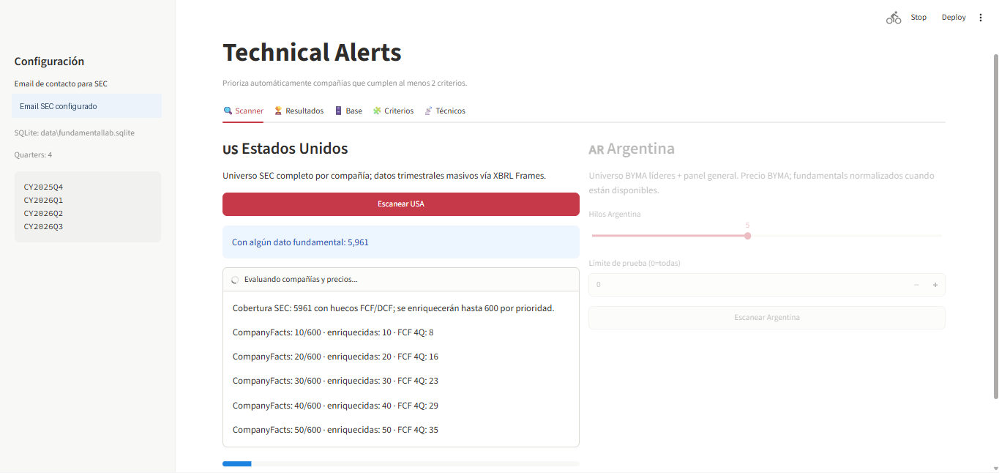
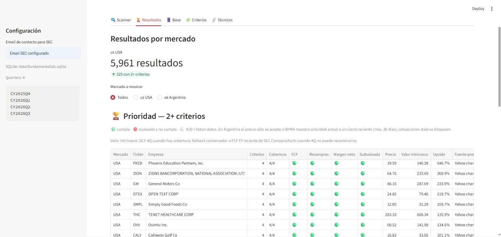
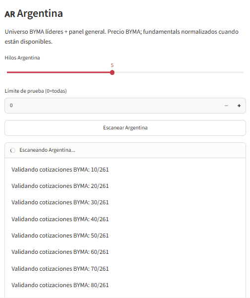
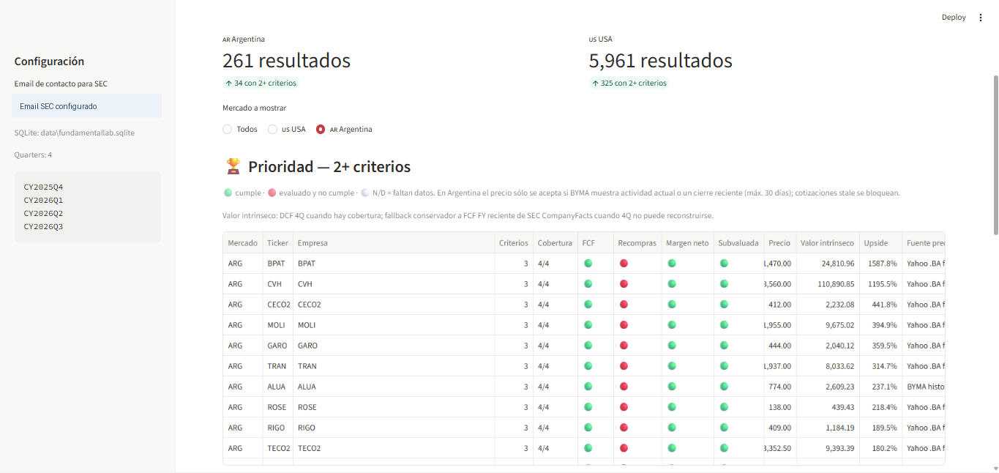

# FundamentalLab — Análisis Fundamental Financiero

Aplicación de escritorio local para explorar empresas de Estados Unidos y Argentina mediante criterios fundamentales y alertas técnicas. FundamentalLab reúne fuentes públicas, normaliza información financiera y organiza los resultados en una interfaz interactiva construida con Streamlit.

> **Descarga para Windows:** [Obtener FundamentalLab.exe](https://github.com/sebastianbocek/FundamentalLab-Analisis-Fundamental-Financiero/releases/latest)
>
> El ejecutable se publica en **Releases** al crear una versión etiquetada (`v*`). Si todavía no hay una versión publicada, descargá el código desde el botón **Code → Download ZIP** y seguí la instalación alternativa.

## Capturas

### Scanner de mercados



### Resultados de Estados Unidos



### Scanner de Argentina



### Resultados de Argentina



## Qué hace

- **Estados Unidos:** arma el universo desde SEC Company Tickers y consulta datos trimestrales SEC XBRL Frames y Company Facts.
- **Argentina:** explora acciones de los paneles líderes y general de BYMA, con precios de BYMA y datos fundamentales normalizados cuando están disponibles.
- **Análisis fundamental:** compara flujo de caja libre, recompras, margen neto y precio frente al valor intrínseco estimado; distingue datos insuficientes de un criterio incumplido.
- **Alertas técnicas:** incluye herramientas de seguimiento técnico y watchlists multi-mercado.
- **Persistencia local:** guarda universos, resultados e historial en SQLite en `data/fundamentallab.sqlite`.
- **Configuración:** permite ajustar los criterios y supuestos del modelo en `fundamentallab/criteria.py`.

El DCF simplificado usa FCF TTM por acción, proyección de cinco años, tasa de descuento del 10%, crecimiento terminal del 2,5% y límite de crecimiento del 15%. Los supuestos se pueden editar en `fundamentallab/criteria.py`.

## Descargar y ejecutar en Windows

1. Descargá `FundamentalLab.exe` desde [Releases](https://github.com/sebastianbocek/FundamentalLab-Analisis-Fundamental-Financiero/releases/latest).
2. Guardalo en una carpeta escribible y ejecutalo. La primera apertura puede tardar unos segundos mientras inicia el servidor local.
3. La aplicación se abre en el navegador en `http://localhost:8501`.
4. Para escanear el universo SEC, ingresá un email de contacto válido en la configuración.

El programa crea su base SQLite en la carpeta `data` junto al ejecutable. Conservá esa carpeta para mantener los datos e historial entre ejecuciones. El escaneo necesita conexión a Internet para consultar las fuentes de mercado y SEC.

## Ejecutar desde el código fuente

Requiere Python 3.10 o posterior.

```powershell
py -m venv .venv
.venv\Scripts\Activate.ps1
python -m pip install -r requirements.txt
streamlit run app.py
```

También se incluyen `install_windows.bat` y `run_fundamentallab.bat` como alternativa de instalación y arranque desde el código fuente.

## Criterios fundamentales

1. FCF reciente superior al de tres trimestres atrás.
2. Crecimiento de recompras.
3. Crecimiento del margen neto.
4. Precio por debajo del valor intrínseco estimado.

La tabla muestra cobertura y estados verde, rojo o N/D. Por defecto prioriza empresas que cumplen al menos dos criterios. Los datos trimestrales pueden faltar, los calendarios fiscales varían y los resultados dependen de los supuestos elegidos.

## Datos y privacidad

La base de datos se mantiene local y no se incluye en el repositorio ni en la descarga. Se consulta SEC, BYMA, Yahoo Finance y otros proveedores usados por las dependencias del proyecto. El email ingresado se usa como identificación de contacto para las solicitudes a SEC.

## Alcance

FundamentalLab es una herramienta de investigación y organización de datos. Las estimaciones, señales y criterios no constituyen asesoramiento financiero ni recomendaciones de inversión. Verificá la información con las fuentes originales antes de tomar decisiones.

## Desarrollo

Las dependencias principales están en `requirements.txt`. La compilación del ejecutable de Windows se define en `.github/workflows/windows-exe.yml` y produce `FundamentalLab.exe` como artefacto de GitHub Actions y como adjunto de las publicaciones de versiones.
